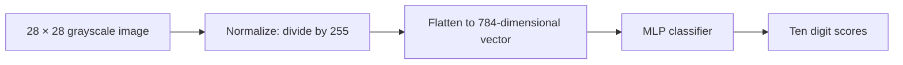
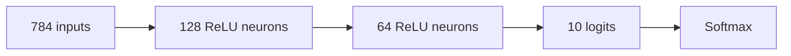
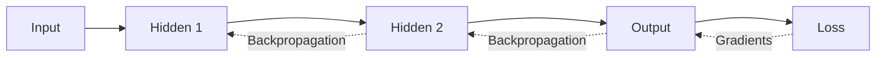
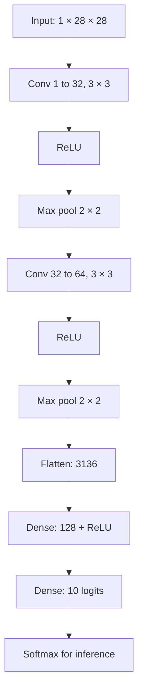

# Mathematics of Handwritten Digit Recognition Using MNIST (28 × 28)

**Lecture notes: From pixel matrices to neural network training, backpropagation, and convolutional neural networks**

These notes derive the mathematics of recognizing handwritten digits from the MNIST dataset. The objective is to explain how a 28 × 28 grayscale image becomes a prediction from 0 to 9, including the necessary linear algebra, calculus, probability, and optimization.

## Contents

1. [The MNIST dataset](#1-the-mnist-dataset)
2. [Preprocessing and vectorization](#2-preprocessing-and-vectorization)
3. [Linear classification and softmax](#3-linear-classification-and-softmax)
4. [Fully connected neural networks](#4-fully-connected-neural-networks)
5. [Counting trainable parameters](#5-counting-trainable-parameters)
6. [One-hot targets](#6-one-hot-targets)
7. [Cross-entropy loss](#7-cross-entropy-loss)
8. [Gradient descent](#8-gradient-descent)
9. [Complete backpropagation derivation](#9-complete-backpropagation-derivation)
10. [Numerical worked example](#10-numerical-worked-example)
11. [Why use convolutional networks](#11-why-use-convolutional-networks)
12. [The convolution operation](#12-the-convolution-operation)
13. [Convolution output size](#13-convolution-output-size)
14. [Feature maps and convolution parameters](#14-feature-maps-and-convolution-parameters)
15. [ReLU and max pooling](#15-relu-and-max-pooling)
16. [Complete MNIST CNN architecture](#16-complete-mnist-cnn-architecture)
17. [Backpropagation through convolution and pooling](#17-backpropagation-through-convolution-and-pooling)
18. [Mini-batch training](#18-mini-batch-training)
19. [Vectorized batch mathematics](#19-vectorized-batch-mathematics)
20. [Adam optimizer](#20-adam-optimizer)
21. [Initialization and regularization](#21-initialization-and-regularization)
22. [Probabilistic interpretation](#22-probabilistic-interpretation)
23. [Numerically stable softmax](#23-numerically-stable-softmax)
24. [Evaluation metrics](#24-evaluation-metrics)
25. [End-to-end training algorithm](#25-end-to-end-training-algorithm)
26. [Equation reference](#26-equation-reference)
27. [Practice problems with solutions](#27-practice-problems-with-solutions)

---

## 1. The MNIST dataset

MNIST is a supervised image-classification dataset with:

| Property | Value |
|---|---|
| Training images | 60,000 |
| Test images | 10,000 |
| Image dimensions | 28 × 28 |
| Channels | 1 (grayscale) |
| Label classes | 10 (digits 0–9) |
| Pixel range | Integers from 0 to 255 |

A single image is a matrix:

$$
X=\begin{bmatrix}
x_{1,1}&x_{1,2}&\cdots&x_{1,28}\\
x_{2,1}&x_{2,2}&\cdots&x_{2,28}\\
\vdots&\vdots&\ddots&\vdots\\
x_{28,1}&x_{28,2}&\cdots&x_{28,28}
\end{bmatrix}\in\mathbb R^{28\times28}.
$$

Black pixels are typically 0, white pixels 255, and intermediate values represent shades of gray. Standard MNIST typically has bright strokes on a dark background.

**Central question:** How can 784 brightness measurements be transformed into ten class probabilities?

## 2. Preprocessing and vectorization

### 2.1 Normalizing the input

Scale each pixel to the interval $[0,1]$:

$$\boxed{x'_{i,j}=\frac{x_{i,j}}{255}}$$

For a pixel with value 204:

$$x'_{i,j}=\frac{204}{255}=0.8.$$

Normalization usually makes the optimization numerically better behaved.

### 2.2 Flattening for a fully connected network

A basic multilayer perceptron (MLP) expects a vector:

$$\boxed{\mathbf x=\operatorname{vec}(X)\in\mathbb R^{784}}.$$

With one-based row-major indexing, the matrix element $(i,j)$ maps to vector index

$$k=28(i-1)+j.$$

Flattening preserves the values but no longer represents the image's two-dimensional structure explicitly. CNNs preserve this structure.



## 3. Linear classification and softmax

The simplest ten-class linear classifier is

$$\boxed{\mathbf z=W\mathbf x+\mathbf b}$$

with dimensions

$$W\in\mathbb R^{10\times784},\quad\mathbf x\in\mathbb R^{784},\quad\mathbf b\in\mathbb R^{10}.$$

The score for digit $k$ is

$$\boxed{z_k=\sum_{j=1}^{784}w_{kj}x_j+b_k},\qquad k\in\{0,\ldots,9\}.$$

These values are *logits*, not probabilities. Softmax converts them to a probability distribution:

$$\boxed{p_k=\frac{e^{z_k}}{\sum_{j=0}^{9}e^{z_j}}}.$$

Consequently, $0<p_k<1$ and $\sum_{k=0}^9p_k=1$. The predicted class is

$$\boxed{\hat y=\operatorname*{arg\,max}_{k}p_k}.$$

Since softmax preserves logit ordering, $\operatorname*{arg\,max}_k p_k=\operatorname*{arg\,max}_k z_k$.

**Linear-model parameter count**:

$$10(784)+10=\boxed{7850}.$$

<details>
<summary><strong>Worked exercise: softmax for three scores</strong></summary>

Suppose the logits are $[1,2,0]$. Then

$$p=\frac{[e^1,e^2,e^0]}{e^1+e^2+e^0}\approx[0.245,0.665,0.090].$$

The predicted class is the second entry (index 1).

</details>

## 4. Fully connected neural networks

A linear classifier cannot learn arbitrary nonlinear shape relationships. Consider the architecture

$$784\longrightarrow128\longrightarrow64\longrightarrow10.$$

### 4.1 First hidden layer

$$\mathbf z^{(1)}=W^{(1)}\mathbf x+\mathbf b^{(1)},\qquad W^{(1)}\in\mathbb R^{128\times784}.$$

Apply ReLU elementwise:

$$\boxed{\mathbf a^{(1)}=\operatorname{ReLU}(\mathbf z^{(1)})},\qquad\operatorname{ReLU}(z)=\max(0,z).$$

For example, $\operatorname{ReLU}(-2)=0$ and $\operatorname{ReLU}(3.5)=3.5$.

### 4.2 Second hidden layer

$$\mathbf z^{(2)}=W^{(2)}\mathbf a^{(1)}+\mathbf b^{(2)},\qquad W^{(2)}\in\mathbb R^{64\times128},$$

$$\mathbf a^{(2)}=\operatorname{ReLU}(\mathbf z^{(2)}).$$

### 4.3 Output layer

$$\mathbf z^{(3)}=W^{(3)}\mathbf a^{(2)}+\mathbf b^{(3)},\qquad W^{(3)}\in\mathbb R^{10\times64},$$

$$\hat{\mathbf p}=\operatorname{softmax}(\mathbf z^{(3)}).$$

### 4.4 One complete forward equation

$$
\boxed{\hat{\mathbf p}=\operatorname{softmax}\!\left(W^{(3)}\operatorname{ReLU}\!\left(W^{(2)}\operatorname{ReLU}(W^{(1)}\mathbf x+\mathbf b^{(1)})+\mathbf b^{(2)}\right)+\mathbf b^{(3)}\right)}.
$$



## 5. Counting trainable parameters

Every connection supplies one weight. Each non-input neuron supplies one bias.

| Layer | Weights | Biases | Total |
|---|---:|---:|---:|
| 784 → 128 | 100,352 | 128 | 100,480 |
| 128 → 64 | 8,192 | 64 | 8,256 |
| 64 → 10 | 640 | 10 | 650 |
| **Total** | | | **109,386** |

For a dense layer with $n_{\text{in}}$ inputs and $n_{\text{out}}$ outputs:

$$\boxed{N_{\text{parameters}}=n_{\text{out}}(n_{\text{in}}+1)}.$$

## 6. One-hot targets

For an image of digit 5, the ten-component target vector is

$$\mathbf y=[0,0,0,0,0,1,0,0,0,0]^T.$$

Formally,

$$y_k=\begin{cases}1,&k=t,\\0,&k\ne t,\end{cases}$$

where $t$ is the true label. Suppose a model predicts

$$\mathbf p=[0.01,0.02,0.01,0.04,0.05,0.75,0.04,0.02,0.04,0.02].$$

The maximum is at digit 5, so the predicted label is 5.

## 7. Cross-entropy loss

For one training image, categorical cross-entropy is

$$\boxed{L=-\sum_{k=0}^9y_k\ln p_k}.$$

For a one-hot target, this reduces to

$$\boxed{L=-\ln p_t}.$$

Two examples:

- If $p_t=0.90$, then $L=-\ln(0.90)\approx0.1054$.
- If $p_t=0.01$, then $L=-\ln(0.01)\approx4.6052$.

A model is penalized strongly for placing very little probability on the correct class.

For $N$ images, mean loss is

$$\boxed{J(\theta)=-\frac1N\sum_{i=1}^N\sum_{k=0}^9y_{ik}\ln p_{ik}}.$$

All learnable weights and biases are collectively denoted $\theta$. Training seeks

$$\boxed{\theta^*=\operatorname*{arg\,min}_{\theta}J(\theta)}.$$

<details>
<summary><strong>Self-check: which prediction has lower cross-entropy?</strong></summary>

For the correct class, compare probabilities $0.7$ and $0.2$.

$$-\ln(0.7)\approx0.3567,\qquad-\ln(0.2)\approx1.6094.$$

The prediction assigning probability $0.7$ to the correct class has lower loss.

</details>

## 8. Gradient descent

The derivative $\partial L/\partial w$ measures how the loss changes locally as a weight changes. Gradient descent updates a weight according to

$$\boxed{w_{\text{new}}=w_{\text{old}}-\eta\frac{\partial L}{\partial w}},$$

where $\eta>0$ is the learning rate. For a matrix:

$$\boxed{W_{\text{new}}=W_{\text{old}}-\eta\nabla_WL}.$$

**Numerical example:** If $w=0.5$, $\eta=0.1$, and $\partial L/\partial w=0.8$, then

$$w_{\text{new}}=0.5-0.1(0.8)=\boxed{0.42}.$$

Gradient descent iterates this process until the model parameters reach a useful solution.

## 9. Complete backpropagation derivation

Backpropagation applies the multivariable chain rule efficiently from the output layer toward the input.

### 9.1 Derivative of softmax

Let

$$p_i=\frac{e^{z_i}}{S},\qquad S=\sum_j e^{z_j}.$$

Using the quotient rule:

$$\frac{\partial p_i}{\partial z_j}=\frac{\delta_{ij}e^{z_i}S-e^{z_i}e^{z_j}}{S^2},$$

where the Kronecker delta is $\delta_{ij}=1$ if $i=j$ and $0$ otherwise. After simplification:

$$\boxed{\frac{\partial p_i}{\partial z_j}=p_i(\delta_{ij}-p_j)}.$$

Therefore,

$$\frac{\partial p_i}{\partial z_i}=p_i(1-p_i),$$

and, when $i\ne j$,

$$\frac{\partial p_i}{\partial z_j}=-p_ip_j.$$

### 9.2 Combine softmax with cross-entropy

Given

$$L=-\sum_i y_i\ln p_i,$$

we have

$$\frac{\partial L}{\partial p_i}=-\frac{y_i}{p_i}.$$

By the chain rule:

$$\frac{\partial L}{\partial z_j}=\sum_i\frac{\partial L}{\partial p_i}\frac{\partial p_i}{\partial z_j}.$$

Substituting the derivatives:

$$\frac{\partial L}{\partial z_j}=-\sum_i y_i(\delta_{ij}-p_j)=-y_j+p_j\sum_i y_i.$$

As $\sum_i y_i=1$ for one-hot targets:

$$\boxed{\frac{\partial L}{\partial z_j}=p_j-y_j}.$$

The output-layer error is therefore

$$\boxed{\boldsymbol\delta^{(3)}=\mathbf p-\mathbf y}.$$

### 9.3 Output-layer weight and bias derivatives

Given $\mathbf z^{(3)}=W^{(3)}\mathbf a^{(2)}+\mathbf b^{(3)}$, a weight affects its corresponding logit as

$$\frac{\partial z_i^{(3)}}{\partial w_{ij}^{(3)}}=a_j^{(2)}.$$

Therefore,

$$\boxed{\frac{\partial L}{\partial w_{ij}^{(3)}}=\delta_i^{(3)}a_j^{(2)}}.$$

In matrix form:

$$\boxed{\nabla_{W^{(3)}}L=\boldsymbol\delta^{(3)}(\mathbf a^{(2)})^T},$$

$$\boxed{\nabla_{b^{(3)}}L=\boldsymbol\delta^{(3)}}.$$

### 9.4 Hidden-layer derivatives

For $z\ne0$, the ReLU derivative is

$$\operatorname{ReLU}'(z)=\begin{cases}1,&z>0,\\0,&z<0.\end{cases}$$

At zero, ReLU is nondifferentiable; implementations choose a subgradient, commonly zero.

The second hidden-layer error is

$$\boxed{\boldsymbol\delta^{(2)}=((W^{(3)})^T\boldsymbol\delta^{(3)})\odot\operatorname{ReLU}'(\mathbf z^{(2)})}.$$

The gradients are

$$\boxed{\nabla_{W^{(2)}}L=\boldsymbol\delta^{(2)}(\mathbf a^{(1)})^T},\qquad\boxed{\nabla_{b^{(2)}}L=\boldsymbol\delta^{(2)}}.$$

For the first hidden layer:

$$\boxed{\boldsymbol\delta^{(1)}=((W^{(2)})^T\boldsymbol\delta^{(2)})\odot\operatorname{ReLU}'(\mathbf z^{(1)})},$$

$$\boxed{\nabla_{W^{(1)}}L=\boldsymbol\delta^{(1)}\mathbf x^T},\qquad\boxed{\nabla_{b^{(1)}}L=\boldsymbol\delta^{(1)}}.$$

Here $\odot$ denotes elementwise multiplication.

### 9.5 Update every layer

For each layer $l$:

$$\boxed{W^{(l)}\leftarrow W^{(l)}-\eta\nabla_{W^{(l)}}L},$$

$$\boxed{\mathbf b^{(l)}\leftarrow\mathbf b^{(l)}-\eta\nabla_{b^{(l)}}L}.$$



## 10. Numerical worked example

To show a full update without 784 inputs, use two inputs and two output classes:

$$\mathbf x=\begin{bmatrix}0.6\\0.8\end{bmatrix},\quad W=\begin{bmatrix}0.2&-0.3\\0.4&0.1\end{bmatrix},\quad\mathbf b=\begin{bmatrix}0.1\\-0.2\end{bmatrix}.$$

**Step 1: Forward pass**

$$z_0=0.2(0.6)-0.3(0.8)+0.1=-0.02,$$

$$z_1=0.4(0.6)+0.1(0.8)-0.2=0.12.$$

Softmax gives

$$\mathbf p\approx\begin{bmatrix}0.4651\\0.5349\end{bmatrix}.$$

If the true label is class 1, then $\mathbf y=[0,1]^T$ and

$$L=-\ln(0.5349)\approx0.6256.$$

**Step 2: Output error**

$$\boldsymbol\delta=\mathbf p-\mathbf y\approx\begin{bmatrix}0.4651\\-0.4651\end{bmatrix}.$$

**Step 3: Weight gradient**

$$\nabla_WL=\boldsymbol\delta\mathbf x^T\approx\begin{bmatrix}0.2791&0.3721\\-0.2791&-0.3721\end{bmatrix}.$$

**Step 4: Update with learning rate $\eta=0.1$**

$$W_{\text{new}}=W-0.1\nabla_WL\approx\begin{bmatrix}0.1721&-0.3372\\0.4279&0.1372\end{bmatrix},$$

$$\mathbf b_{\text{new}}=\mathbf b-0.1\boldsymbol\delta\approx\begin{bmatrix}0.05349\\-0.15349\end{bmatrix}.$$

The probability of the correct class rises from about $0.5349$ to $0.5684$, reducing the loss from about $0.6256$ to $0.5649$.

## 11. Why use convolutional networks

An MLP operates on a flattened image, while a convolutional neural network (CNN) retains the arrangement of nearby pixels. Filters can respond to local edges, curves, corners and stroke configurations. The same filter is reused at many spatial positions; this is called **weight sharing**.

A CNN is therefore a natural model for handwritten-digit recognition.

## 12. The convolution operation

Consider a 5 × 5 input matrix:

$$X=\begin{bmatrix}1&0&1&0&1\\0&1&1&1&0\\1&1&0&1&1\\0&0&1&0&1\\1&0&1&1&0\end{bmatrix}$$

and a 3 × 3 filter:

$$K=\begin{bmatrix}1&0&-1\\1&0&-1\\1&0&-1\end{bmatrix}.$$

For the top-left input patch,

$$X_{\text{patch}}=\begin{bmatrix}1&0&1\\0&1&1\\1&1&0\end{bmatrix}.$$

Multiply corresponding entries and sum:

$$Y_{1,1}=1(1)+0(0)+1(-1)+0(1)+1(0)+1(-1)+1(1)+1(0)+0(-1)=\boxed{0}.$$

General formula:

$$\boxed{Y_{i,j}=\sum_{u=0}^{K_h-1}\sum_{v=0}^{K_w-1}X_{i+u,j+v}K_{u,v}+b}.$$

This is technically *cross-correlation*, because the filter has not been flipped. Neural-network libraries commonly call this operation convolution.

<details>
<summary><strong>Exercise: manually apply the filter to another patch</strong></summary>

Consider the patch

$$P=\begin{bmatrix}1&0&0\\1&0&0\\1&0&0\end{bmatrix}.$$

Using the same kernel $K$, calculate $\sum_{u,v}P_{u,v}K_{u,v}$.

**Solution:** Each of the three left-column pixels contributes $1$; other terms contribute zero. Output: $3$.

</details>

## 13. Convolution output size

For input height $H_{\mathrm{in}}$, kernel height $K_h$, zero padding $P_h$, stride $S_h$, and dilation $D_h$:

$$\boxed{H_{\mathrm{out}}=\left\lfloor\frac{H_{\mathrm{in}}+2P_h-D_h(K_h-1)-1}{S_h}+1\right\rfloor}.$$

Likewise,

$$\boxed{W_{\mathrm{out}}=\left\lfloor\frac{W_{\mathrm{in}}+2P_w-D_w(K_w-1)-1}{S_w}+1\right\rfloor}.$$

For a 28 × 28 input and a 3 × 3 kernel with stride 1, no padding, dilation 1:

$$H_{\mathrm{out}}=\frac{28-3}{1}+1=26.$$

Output dimensions are 26 × 26. With padding 1, dimensions remain 28 × 28.

## 14. Feature maps and convolution parameters

For $C_{\mathrm{in}}$ input channels and $C_{\mathrm{out}}$ learned filters, the output has $C_{\mathrm{out}}$ channels. A multi-channel convolution is

$$\boxed{Y_{o,i,j}=b_o+\sum_{c=1}^{C_{\mathrm{in}}}\sum_{u=0}^{K_h-1}\sum_{v=0}^{K_w-1}K_{o,c,u,v}X_{c,i+u,j+v}}.$$

For stride and padding, replace the indexed input with $X_{c,iS_h+u-P_h,jS_w+v-P_w}$, interpreting out-of-bounds input as zero under zero padding.

The number of trainable parameters is

$$\boxed{N_{\mathrm{params}}=C_{\mathrm{out}}(C_{\mathrm{in}}K_hK_w+1)}.$$

For 32 filters of size 3 × 3 operating on a single-channel MNIST image:

$$N_{\mathrm{params}}=32(1\cdot3\cdot3+1)=\boxed{320}.$$

The same kernel weights operate at every spatial position.

## 15. ReLU and max pooling

### 15.1 ReLU

Following convolution, apply

$$\boxed{A_{o,i,j}=\max(0,Y_{o,i,j})}.$$

For example,

$$\begin{bmatrix}2&-1&3\\-4&5&0\\1&-2&6\end{bmatrix}\longrightarrow\begin{bmatrix}2&0&3\\0&5&0\\1&0&6\end{bmatrix}.$$

### 15.2 Max pooling

With non-overlapping 2 × 2 pooling and stride 2, replace each 2 × 2 block by its maximum. For

$$A=\begin{bmatrix}1&3&2&4\\5&6&1&2\\0&2&8&3\\1&4&2&7\end{bmatrix},$$

we obtain

$$\boxed{P=\begin{bmatrix}6&4\\4&8\end{bmatrix}}.$$

Thus spatial dimensions change from 4 × 4 to 2 × 2. Pooling has no trainable weights and reduces spatial resolution.

## 16. Complete MNIST CNN architecture

Example architecture with 3 × 3 convolutions, stride 1, padding 1:



| Layer | Output shape | Trainable parameters |
|---|---|---:|
| Input | 1 × 28 × 28 | 0 |
| Conv (1 → 32, 3 × 3) | 32 × 28 × 28 | 320 |
| ReLU | 32 × 28 × 28 | 0 |
| MaxPool (2 × 2) | 32 × 14 × 14 | 0 |
| Conv (32 → 64, 3 × 3) | 64 × 14 × 14 | 18,496 |
| ReLU | 64 × 14 × 14 | 0 |
| MaxPool (2 × 2) | 64 × 7 × 7 | 0 |
| Flatten | 3,136 | 0 |
| Dense (3136 → 128) | 128 | 401,536 |
| ReLU | 128 | 0 |
| Dense (128 → 10) | 10 | 1,290 |
| Softmax | 10 | 0 |
| **Total** | | **421,642** |

Check the second convolution:

$$64(32\cdot3\cdot3+1)=18,496.$$

Check the first dense layer:

$$3136(128)+128=401,536.$$

The large dense layer accounts for most parameters. Other CNN designs can use global average pooling to reduce this number.

## 17. Backpropagation through convolution and pooling

### 17.1 Kernel-gradient derivation

For a single-channel valid convolution

$$Y_{i,j}=\sum_{u,v}K_{u,v}X_{i+u,j+v},$$

let the upstream gradient be

$$G_{i,j}=\frac{\partial L}{\partial Y_{i,j}}.$$

A filter weight is reused at many positions, so the gradient accumulates contributions from every position:

$$\boxed{\frac{\partial L}{\partial K_{u,v}}=\sum_{i,j}G_{i,j}X_{i+u,j+v}}.$$

The bias gradient is

$$\boxed{\frac{\partial L}{\partial b}=\sum_{i,j}G_{i,j}}.$$

The gradient with respect to an input pixel is

$$\boxed{\frac{\partial L}{\partial X_{m,n}}=\sum_{\substack{i,j,u,v\\i+u=m,\ j+v=n}}G_{i,j}K_{u,v}}.$$

For multiple channels, include the corresponding sums over channels.

### 17.2 Gradient through max pooling

If $y=\max(x_1,x_2,x_3,x_4)$ and $x_2$ is uniquely largest, then

$$\frac{\partial y}{\partial x_2}=1,\qquad\frac{\partial y}{\partial x_i}=0\text{ for }i\ne2.$$

Thus the upstream gradient goes to the selected maximum input. Tied maxima require a subgradient convention.

## 18. Mini-batch training

For $B$ examples, average their losses:

$$\boxed{L_{\mathrm{batch}}=\frac1B\sum_{i=1}^B L_i}.$$

The corresponding parameter gradient is

$$\boxed{\nabla_\theta L_{\mathrm{batch}}=\frac1B\sum_{i=1}^B\nabla_\theta L_i}.$$

If $B=64$, a batch of MNIST images has tensor shape

$$\boxed{64\times1\times28\times28}.$$

The CNN produces 64 × 10 logits. A training epoch processes the entire training dataset once. With 60,000 images and batch size 64,

$$\left\lceil\frac{60000}{64}\right\rceil=\boxed{938}\text{ batches per epoch}.$$

Ten epochs give 9,380 updates if the partial final batch is retained.

## 19. Vectorized batch mathematics

For a dense network storing samples as columns:

$$X\in\mathbb R^{784\times B}.$$

First layer:

$$Z^{(1)}=W^{(1)}X+\mathbf b^{(1)}\mathbf1_B^T.$$

Activations:

$$A^{(1)}=\operatorname{ReLU}(Z^{(1)}).$$

Apply softmax separately to each column of the output logits. With mean batch cross-entropy, the output error is

$$\boxed{\Delta^{(3)}=\frac{P-Y}{B}}.$$

Then

$$\boxed{\nabla_{W^{(3)}}L=\Delta^{(3)}(A^{(2)})^T},$$

$$\boxed{\nabla_{b^{(3)}}L=\Delta^{(3)}\mathbf1_B}.$$

This allows fast vectorized training.

## 20. Adam optimizer

Adam maintains moving averages of gradients and squared gradients:

$$\boxed{m_t=\beta_1m_{t-1}+(1-\beta_1)g_t},$$

$$\boxed{v_t=\beta_2v_{t-1}+(1-\beta_2)g_t^2}.$$

The square is elementwise. Correct their initialization bias:

$$\hat m_t=\frac{m_t}{1-\beta_1^t},\qquad\hat v_t=\frac{v_t}{1-\beta_2^t}.$$

Update the parameters:

$$\boxed{\theta_t=\theta_{t-1}-\eta\frac{\hat m_t}{\sqrt{\hat v_t}+\epsilon}}.$$

Common defaults include $\beta_1=0.9$, $\beta_2=0.999$, and $\epsilon=10^{-8}$.

## 21. Initialization and regularization

### 21.1 He initialization

For ReLU networks, one useful weight initialization is

$$\boxed{w_{ij}\sim\mathcal N\left(0,\frac{2}{n_{\mathrm{in}}}\right)}.$$

For $n_{\mathrm{in}}=784$:

$$\operatorname{Std}(w)=\sqrt{\frac{2}{784}}\approx0.0505.$$

### 21.2 L2 regularization

Penalize large weights:

$$\boxed{J_{\mathrm{reg}}=J_{\mathrm{CE}}+\frac\lambda2\sum_l\|W^{(l)}\|_F^2}.$$

Then

$$\boxed{\nabla_{W^{(l)}}J_{\mathrm{reg}}=\nabla_{W^{(l)}}J_{\mathrm{CE}}+\lambda W^{(l)}}.$$

Decoupled weight decay in AdamW is related, but is not identical to adding an L2 loss penalty when using adaptive optimization.

### 21.3 Dropout

During training, inverted dropout uses a mask

$$m_i\sim\operatorname{Bernoulli}(q),\qquad\boxed{\tilde a_i=\frac{m_i a_i}{q}}.$$

Here $q$ is the probability of retaining an activation. Dropout is disabled during evaluation.

### 21.4 Data augmentation

Transformations may be used during training:

$$X'=T(X).$$

A useful mathematical objective is

$$\min_\theta\mathbb E_{(X,y),T}[L(f_\theta(T(X)),y)].$$

Small rotations, shifts, or deformations can help if they preserve the correct digit label.

## 22. Probabilistic interpretation

A classifier models the conditional probability

$$\boxed{P(Y=k\mid X;\theta)=\frac{\exp(z_k(X;\theta))}{\sum_{j=0}^{9}\exp(z_j(X;\theta))}}.$$

For independent labeled examples, the conditional likelihood is

$$\mathcal L(\theta)=\prod_{i=1}^N P(Y=y_i\mid X_i;\theta).$$

Taking logarithms:

$$\ln\mathcal L(\theta)=\sum_{i=1}^N\ln P(Y=y_i\mid X_i;\theta).$$

Maximizing this log-likelihood is equivalent to minimizing mean cross-entropy:

$$\boxed{J(\theta)=-\frac1N\sum_{i=1}^N\ln P(Y=y_i\mid X_i;\theta)}.$$

Predicted softmax values are a model probability distribution, but they are not automatically calibrated estimates of the model's actual correctness.

## 23. Numerically stable softmax

Direct exponentiation of very large logits can overflow. Subtract the largest logit:

$$m=\max_j z_j.$$

Then compute

$$\boxed{p_k=\frac{e^{z_k-m}}{\sum_j e^{z_j-m}}}.$$

This produces the same probabilities because the common factor $e^{-m}$ cancels.

Cross-entropy can be computed stably from logits as

$$\boxed{L=-z_t+m+\ln\left(\sum_j e^{z_j-m}\right)}.$$

In PyTorch, `torch.nn.CrossEntropyLoss` accepts logits directly; applying softmax before it is unnecessary.

## 24. Evaluation metrics

### 24.1 Accuracy

$$\boxed{\operatorname{Accuracy}=\frac{\text{correct predictions}}{\text{total predictions}}\times100\%}.$$

For an illustrative 9,850 correct classifications out of 10,000 test images:

$$\operatorname{Accuracy}=\frac{9850}{10000}\times100=\boxed{98.5\%}.$$

This is an example, not a measured result for the architecture above.

### 24.2 Confusion matrix

For a ten-class problem:

$$C_{ij}=\#\{\text{true class }i\text{ predicted as class }j\},\qquad C\in\mathbb N^{10\times10}.$$

Diagonal elements represent correct predictions. Off-diagonal elements represent confusion between digits.

### 24.3 Precision, recall, F1

For digit $k$:

$$\operatorname{Precision}_k=\frac{TP_k}{TP_k+FP_k},$$

$$\operatorname{Recall}_k=\frac{TP_k}{TP_k+FN_k},$$

$$\boxed{F1_k=2\frac{\operatorname{Precision}_k\operatorname{Recall}_k}{\operatorname{Precision}_k+\operatorname{Recall}_k}}.$$

## 25. End-to-end training algorithm

Given the labeled training dataset

$$\mathcal D=\{(X_i,y_i)\}_{i=1}^{60000},$$

we aim to minimize

$$\boxed{\theta^*=\operatorname*{arg\,min}_\theta\frac1{60000}\sum_{i=1}^{60000}L(f_\theta(X_i),y_i)}.$$

In practice, use mini-batch optimization:

```text
1. Load 60,000 training images and labels.
2. Normalize pixel values to [0, 1].
3. Initialize model weights and biases.
4. For each epoch:
      Shuffle training examples.
      For each mini-batch:
          a. Apply convolution.
          b. Apply ReLU activations.
          c. Apply max pooling.
          d. Flatten the feature maps.
          e. Calculate dense-layer logits.
          f. Calculate cross-entropy loss.
          g. Backpropagate the gradients.
          h. Update parameters with the optimizer.
5. Use separate validation data for model selection.
6. Evaluate the final model on the untouched test set.
```

After training, inference is simply

$$X_{\mathrm{normalized}}=\frac{X_{\mathrm{new}}}{255},$$

$$\mathbf z=f_{\theta^*}(X_{\mathrm{normalized}}),$$

$$\boxed{\hat y=\operatorname*{arg\,max}_{k\in\{0,\ldots,9\}}\operatorname{softmax}(\mathbf z)_k}.$$

Real-world handwriting may require consistent foreground/background polarity, resizing, centering, and matching the MNIST preprocessing conventions.

## 26. Equation reference

| Concept | Equation | Role |
|---|---|---|
| Image | $X\in\mathbb R^{28\times28}$ | Input image representation |
| Normalization | $x'=x/255$ | Scale pixels |
| Dense layer | $z=Wx+b$ | Weighted combination |
| ReLU | $a=\max(0,z)$ | Nonlinearity |
| Convolution | $Y_{ij}=\sum_{u,v}K_{uv}X_{i+u,j+v}$ | Local feature extraction |
| Softmax | $p_k=e^{z_k}/\sum_j e^{z_j}$ | Class probabilities |
| Cross-entropy | $L=-\sum_k y_k\ln p_k$ | Training loss |
| Output derivative | $\delta=p-y$ | Start backpropagation |
| Dense gradient | $\nabla_WL=\delta a^T$ | Weight sensitivity |
| Gradient descent | $W\leftarrow W-\eta\nabla_WL$ | Parameter update |
| Classification | $\hat y=\operatorname*{arg\,max}_k p_k$ | Final digit |

## 27. Practice problems with solutions

These sections are expandable in GitHub's Markdown renderer. Try each problem before opening its solution.

<details>
<summary><strong>Problem 1. How many values are in a 28 × 28 MNIST image?</strong></summary>

$$28\times28=784.$$  A flattened grayscale image has 784 intensity values.

</details>

<details>
<summary><strong>Problem 2. Normalize pixel values 0, 128, and 255.</strong></summary>

$$0/255=0,\quad128/255\approx0.502,\quad255/255=1.$$

</details>

<details>
<summary><strong>Problem 3. Find the parameter count for a dense layer from 784 features to 32 neurons.</strong></summary>

$$32(784+1)=\boxed{25,120}.$$

</details>

<details>
<summary><strong>Problem 4. Find output width for a 28-pixel input, 5-pixel kernel, stride 1, no padding, no dilation.</strong></summary>

$$\frac{28-5}{1}+1=\boxed{24}.$$

</details>

<details>
<summary><strong>Problem 5. Find parameters for 16 filters of size 5 × 5 with 3 input channels.</strong></summary>

$$16(3\cdot5\cdot5+1)=16(76)=\boxed{1216}.$$

</details>

<details>
<summary><strong>Problem 6. Why does softmax with cross-entropy produce the derivative p minus y?</strong></summary>

Use the softmax Jacobian $\partial p_i/\partial z_j=p_i(\delta_{ij}-p_j)$ and $\partial L/\partial p_i=-y_i/p_i$. The chain rule gives $-y_j+p_j\sum_i y_i$, which becomes $p_j-y_j$ because the one-hot target sums to 1.

</details>

<details>
<summary><strong>Problem 7. What happens to the derivative during 2 × 2 max pooling?</strong></summary>

The incoming gradient is assigned to the selected maximum element; gradients to the other elements are zero, assuming a unique maximum.

</details>

---

## Final summary

Handwritten-digit recognition combines matrix representations of images, nonlinear feature extraction, probabilistic classification, and gradient-based learning:

$$
\boxed{\text{Image}\;\xrightarrow{\text{forward pass}}\;\text{Probabilities}\;\xrightarrow{\text{compare with label}}\;\text{Loss}\;\xrightarrow{\text{backpropagation}}\;\text{Gradients}\;\xrightarrow{\text{optimizer}}\;\text{Updated weights}}.
$$

The same mathematical framework applies beyond MNIST to optical character recognition, industrial image inspection, and robot perception.

**Reading note:** This document is designed for standard GitHub Markdown rendering. GitHub supports mathematical expressions, Mermaid diagrams, and expandable `<details>` sections, but does not execute live Python or JavaScript inside a README.
